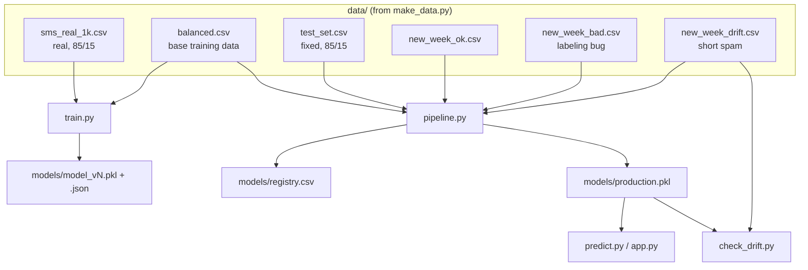

# Instructor Guide: MLOps 101 Lab

## Goal

Students experience the MLOps loop end to end, using code small enough to read in one sitting. The ML is intentionally weak (logistic regression on two features) so that the **operational** problems show up clearly: a misleading metric, a bad data batch, a model that must be rolled back, and drift.

## Learning objectives

By the end, students can:

1. Explain why accuracy can hide a useless model, and use recall and a confusion matrix.
2. Describe what makes a training run reproducible and accountable (seed, data fingerprint, model card).
3. Describe the steps of a retraining pipeline and the purpose of a quality gate.
4. Roll back to an earlier model version using a model registry.
5. Detect data drift and explain why retraining alone does not always fix it.

## Before class

- [ ] Run the whole lab once on the machine you will present from (about 5 minutes; see [SOLUTION.md](SOLUTION.md)).
- [ ] Make sure students have Python 3.9+ and can `pip install` (or use Colab or a lab machine).
- [ ] Optional: Docker Desktop installed if you want to demo the container stretch goal.
- [ ] Reset the folder before class: delete `models/`, `mlops_nb/`, `mlops_basics/` and the generated CSVs in `data/` (keep `data/sms_real_1k.csv`).
- [ ] Notebook track: check that students have JupyterLab 4.1+ (or Notebook 7.1+, or VS Code), so the Mermaid diagrams render. Run all three notebooks once.

## Timing (about 60 minutes)

```mermaid
gantt
    dateFormat mm
    axisFormat %M min
    section Lab
    Part 0 Setup            :p0, 00, 5m
    Part 1 Accuracy trap    :p1, after p0, 10m
    Part 2 Reproducibility  :p2, after p1, 5m
    Part 3 Serve            :p3, after p2, 10m
    Part 4 Pipeline + gate  :p4, after p3, 15m
    Part 5 Safe rollout     :p5, after p4, 5m
    Part 6 Drift            :p6, after p5, 10m
```

If you are short on time, make Part 3's stretch goal and Part 5 homework. **Do not cut Part 4.** It is the core of the lab.

## Slide mapping

| Lab part | Slide(s) | Key message |
|---|---|---|
| 1 Train | 6 Running example, 7 Accuracy trap | Pick the right metric; look at the confusion matrix |
| 2 Reproduce | 4 Four things a good ML system must be | Seeds plus data fingerprints plus model cards |
| 3 Serve | 9 Docker, 10 Serving | A model must be callable; packaging makes it portable |
| 4 Pipeline | 11 Retraining pipeline | Automate it, version it, and gate it |
| 5 Rollout | 12 Shipping safely | Shadow, canary, blue/green |
| 6 Drift | 13 Drift | The world changes; monitor and close the loop |
| Notebooks | 14 Metrics, 15 Three notebooks, 16 What the lab shows | Precision vs recall; which notebook to run; the numbers students will see |

> Naming note: slide 7 calls the imbalanced model "v2" and the balanced one "v3" (from Lab 1). In this lab they are **v1** (real, imbalanced) and **v2** (balanced). The lesson is the same. In the MLOps notebooks, the pipeline's new versions continue as v3, v4, and so on.

## How the lab is built

**Design choices worth knowing:**

- **The test set is 85% ham / 15% spam,** like real traffic. This is why the bad model in Part 4b still scores about 87% accuracy. That is the trap the students fall into, on purpose.
- **`new_week_bad.csv`** has 1,500 spam-like messages labeled "ham." The candidate model learns to say "ham" much more often. Accuracy stays above the 85% gate, but spam recall collapses to about 12%.
- **`new_week_drift.csv`** has spam with an average length of about 45 characters, which overlaps with ham (about 50). With only `length` and `punct`, no retraining can fully separate the two. This makes a good bridge to deep learning: we need features from the *words*, not the shape of the message.
- `make_data.py` uses a fixed seed (42), so every student gets the same numbers. Only the timestamps in version names differ.

## The notebook track

The notebooks tell the same story as the command-line lab, using the students' own models. Each one has a **Part A · Starter** (explanations, `# TODO` cells, questions) and a **Part B · Solution** (the same cells filled in, plus answers) that runs on its own.

| Notebook | Audience | Time | Covers |
|---|---|---|---|
| [train_model.ipynb](train_model.ipynb) | Everyone, first | 30–40 min | Lab Parts 1–3: split, train, the accuracy trap, precision/recall/F1, the decision threshold, model cards. Saves `model_nb_v1` and `model_nb_v2` |
| [mlops_basics.ipynb](mlops_basics.ipynb) | New to data science | 30–40 min | Five steps: save versions, quality gate, serve, retrain + rollback, drift. One-line TODOs and friendly errors |
| [mlops_pipeline.ipynb](mlops_pipeline.ipynb) | Comfortable with Python and pandas | 60–90 min | Lab Parts 2–6 in depth: registry and lineage, reproducibility, gate kinds, an API with error handling, the pipeline, rollback and data validation, shadow/canary/blue-green, drift and a refreshed test set, a weekly job |

**Suggested use:** assign `train_model.ipynb` to everyone, then let students choose the basics or the full MLOps notebook. The full notebook works well as homework after the in-class lab.

**Numbers students will see** (fixed seed, so everyone matches):

| Moment | Result |
|---|---|
| v1 vs an accuracy-only gate | 85.6% accuracy passes, with 4% recall (3 of 75 spam) |
| Bad-data week, accuracy-only gate | 86.8% accuracy, 12% recall: promoted, then rolled back |
| Bad-data week, recall rule (≥ 0.80) | Blocked |
| Shadow test of the bad model | Candidate flags 1.8% of messages as spam vs 15.6% for production |
| Drift week | Average length −53%; production recall 1.6% |
| Retrained on drift data | Passes on the old test set; fails on a refreshed one (recall 54%) |

**Things to know:**
- Each MLOps notebook works in its own folder (`mlops_nb/` or `mlops_basics/`) and empties it when its setup cell runs. Students who re-run setup must re-run everything after it.
- The starter sections stop at the first unfilled TODO. That is by design: later sections use earlier results.
- **Students who could not finish `train_model.ipynb`** can run `python make_solution_models.py`. It retrains v1 and v2 exactly as that notebook's solution does (same weights, same model cards) and saves the files the MLOps notebooks need. It skips models that already exist unless given `--force`, so it never overwrites a student's own work by accident.

## Talking points by part

**Part 1.** Ask the class to predict v1's accuracy before running it. Then show recall = 0%. "A model that always says ham would get the same score."

**Part 2.** Ask: "Your model misbehaves in production six months from now. What do you need to know?" Answers: the code version (git), the data version (fingerprint), the parameters, and the metrics at training time. That is the model card.

**Part 3.** The `WINNER!!` message is short, so the model calls it ham. Don't fix this. Use it to show that **operational excellence cannot fix a weak model**, and that monitoring would surface it.

**Part 4.** This is the "aha" moment. Let students run 4b and *celebrate* the PASS before asking them to look at recall. Connect it back to slide 7: "Our gate made the exact mistake we warned about."

**Part 5.** Shadow deployment would have caught the bad model with zero user impact, by comparing its predictions with the current model's. Blue/green gives the fastest rollback.

**Part 6.** Two lessons: (1) drift detection works without labels by comparing feature averages, and (2) retraining passes the gate because the **test set is old**. In production you must refresh the test set too.

## Common problems

| Symptom | Fix |
|---|---|
| `python: command not found` | Use `python3` and `pip3` (macOS/Linux) |
| `FileNotFoundError: data/balanced.csv` | Run `python make_data.py` first, from inside this folder |
| `FileNotFoundError: models/production.pkl` | Run Part 4a (`pipeline.py data/new_week_ok.csv`) before `predict.py` with no model argument, `app.py` or `check_drift.py` |
| `NameError: SPAM_RECALL_MIN` | The student fixed the gate function but did not uncomment or define the constant |
| Bad batch still passes after the fix | The constant is defined but `passes_gate` does not use it, or `ok =` was overwritten instead of combined |
| `cat` not found (Windows) | Use `type models\model_v2.json` |
| Docker build fails on `COPY models/production.pkl` | Run the pipeline first so the file exists |
| Notebook: `models/model_nb_v1.pkl is missing` | Run all of `train_model.ipynb` first, or `python make_solution_models.py` |
| Notebook: `Finish the TODO ...` or `The registry should have v1 and v2` | A starter TODO is unfilled. Fill it in or copy the Part B cell |
| Notebook: `mlops_nb/versions/v2.pkl does not exist` | Section 1c was skipped, or setup was re-run. Run the cells in order from setup |
| Notebook diagrams show as text | Jupyter is too old for Mermaid. Upgrade to JupyterLab 4.1+ or use VS Code |

## Extension ideas (homework or advanced students)

- Replace the 2 numeric features with TF-IDF on the raw text, or a small neural network. Does the drift problem go away?
- Make `check_drift.py` run automatically and trigger `pipeline.py` when drift is found.
- Add the data fingerprint and git commit hash to `registry.csv`.
- Turn `pipeline.py` into a GitHub Actions workflow that runs when a new CSV is pushed.
- Implement shadow mode in `predict.py`: run both `production.pkl` and a candidate, log both, and return only production's answer.
