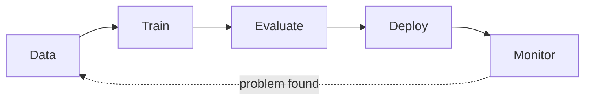
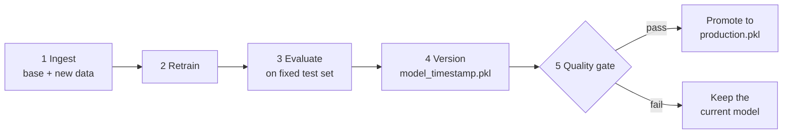
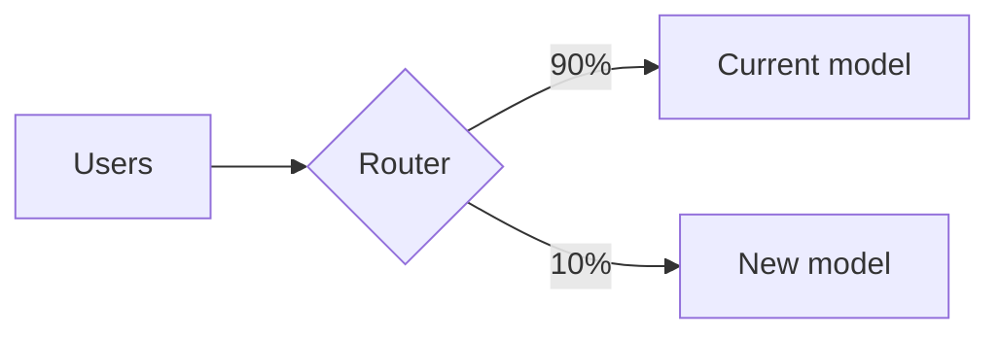
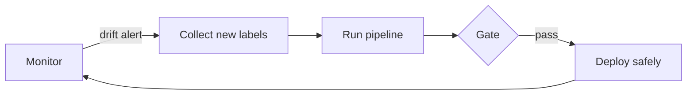

# In-Class Lab: MLOps 101 with a Spam Classifier

**Time:** about 60 minutes  **You need:** Python 3.9+ and a terminal

## What you will do

You will play the role of the ML team that owns a spam filter. You will train it, package it, automate retraining, stop a bad model from reaching users, and notice when the world changes.



Our model is deliberately tiny. It only looks at **two numbers** for each message:

| Feature | Meaning | Example: `WINNER!! Claim your free prize now!!!` |
|---|---|---|
| `length` | number of characters | 37 |
| `punct` | number of punctuation marks | 5 |

Answer the **questions** (Q1, Q2, ...) in a notebook or text file as you go.

> **Prefer Jupyter?** The same lab exists as notebooks: [train_model.ipynb](train_model.ipynb), then [mlops_basics.ipynb](mlops_basics.ipynb) (new to data science) or [mlops_pipeline.ipynb](mlops_pipeline.ipynb). See the [README](README.md#quick-start-notebooks). Their questions are numbered separately from Q1–Q13 here.

---

## Part 0 · Setup (5 min)

Open a terminal **in this folder** and run:

```bash
pip install -r requirements.txt
python make_data.py
```

> On a Mac you may need `python3` and `pip3` instead of `python` and `pip`.

`make_data.py` creates the datasets you will use:

| File | What it is |
|---|---|
| `data/sms_real_1k.csv` | Real messages: 85% ham, 15% spam |
| `data/balanced.csv` | 1,000 ham + 1,000 spam |
| `data/test_set.csv` | A **fixed** test set we always use to compare models |
| `data/new_week_*.csv` | New batches of data that "arrive" each week |

---

## Part 1 · Train and the accuracy trap (10 min) · *slides 6–7*

Train a model on the **real, imbalanced** data:

```bash
python train.py data/sms_real_1k.csv v1
```

Now train one on the **balanced** data:

```bash
python train.py data/balanced.csv v2
```

Fill in this table from your output:

| Model | Data | Accuracy | Spam recall |
|---|---|---|---|
| v1 | real, imbalanced | | |
| v2 | balanced | | |

> **Spam recall** = of all the real spam messages, what share did we catch?

**Q1.** v1 has a "good" accuracy. Look at its confusion matrix. What is it actually doing?

**Q2.** Why is accuracy a misleading metric when 85% of messages are ham?

---

## Part 2 · Reproducible and accountable (5 min) · *slide 4*

Every time `train.py` saves a model, it also saves a **model card**: a small JSON file that says how the model was made.

```bash
cat models/model_v2.json
```

> On Windows use `type models\model_v2.json`

Now train v2 again and compare:

```bash
python train.py data/balanced.csv v2
cat models/model_v2.json
```

**Q3.** Did the metrics change? What makes the result repeatable? (Hint: look for `random_state` in `train.py`.)

**Q4.** What is `data_fingerprint`? When would it change, and why is that useful six months from now?

---

## Part 3 · Serve the model (10 min) · *slides 9–10*

A model is only useful when something can **call it**. Try our v2 model:

```bash
python predict.py "See you at lunch" models/model_v2.pkl
python predict.py "URGENT! You have won a 1000 dollar gift card. Call 0800-123-456 now to claim your prize, offer ends today!!! Reply STOP to opt out." models/model_v2.pkl
python predict.py "WINNER!! Claim your free prize now!!!" models/model_v2.pkl
```

**Q5.** The last message is obviously spam. Why does the model say HAM? (Look at the features it prints.)

**Q6.** What would a better model need to look at? How could deep learning help here?

**Stretch (optional, after Part 4):** run the web app, or package it with Docker.

```bash
streamlit run app.py
```

```bash
docker build -t spam-lab .
docker run -p 8501:8501 spam-lab
```

---

## Part 4 · A pipeline with a quality gate (15 min) · *slide 11*

In real life, new data arrives every week and the model is retrained **automatically**. `pipeline.py` does this:



### 4a. A normal week

```bash
python pipeline.py data/new_week_ok.csv
```

You now have a `models/production.pkl` and a `models/registry.csv` that logs every run.

### 4b. A bad week

Someone upstream had a bug: most spam in this batch was labeled as "ham."

```bash
python pipeline.py data/new_week_bad.csv
```

**Q7.** Did the gate pass? Look at the spam recall. Should this model be in production?

### 4c. Fix the gate

Open `pipeline.py` and find the two `TODO (Part 4)` lines in the **Quality gate** section. Make the gate also require a **spam recall of at least 0.80**.

### 4d. Roll back, then try again

The bad model is in production right now. Open `models/registry.csv`, find the version from the **good week** (4a), and roll back:

```bash
python rollback.py <good_version_name>
```

Run the bad week again:

```bash
python pipeline.py data/new_week_bad.csv
```

**Q8.** What happened this time? Why do we save **every** version, even ones we do not promote?

---

## Part 5 · Ship it safely (5 min, discussion) · *slide 12*

No code here. Talk with your neighbor.



**Q9.** Suppose the bad model from 4b had slipped through. Which strategy, **shadow**, **canary** or **blue/green**, would have let you find the problem *without* any user getting a wrong answer? Which one gives the fastest rollback?

---

## Part 6 · Monitoring and drift (10 min) · *slide 13*

Spammers adapt. Let's check if new data still looks like our training data.

```bash
python check_drift.py data/new_week_ok.csv
python check_drift.py data/new_week_drift.csv
```

**Q10.** Which features drifted, and in which direction? How did the production model's spam recall change?

Now let the pipeline retrain on the new data and check again:

```bash
python pipeline.py data/new_week_drift.csv
python check_drift.py data/new_week_drift.csv
```

**Q11.** The gate passed, but recall on the drifted data is still low. Why? (Hint: which data is in `test_set.csv`? Which features does the model have?)



---

## Wrap-up

**Q12.** In one sentence each, say which part of today's lab showed each of these: *reproducible*, *accountable*, *continuous*.

**Q13.** Name one thing you would add to this project to reach "Level 4: Full MLOps."

Submit your answers to Q1–Q13.
