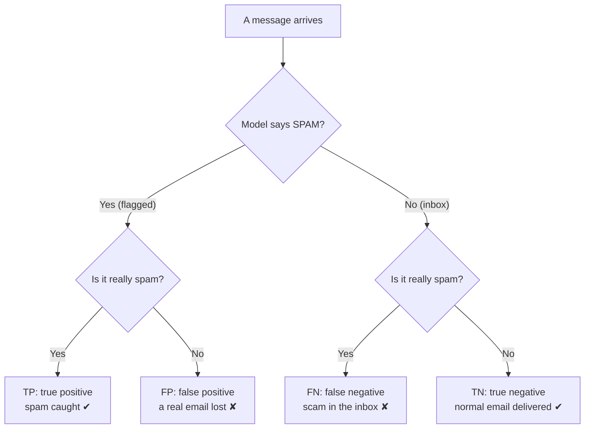
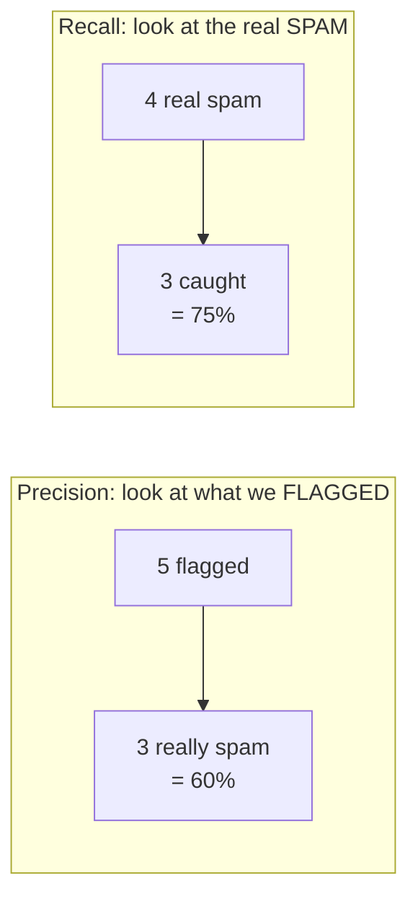
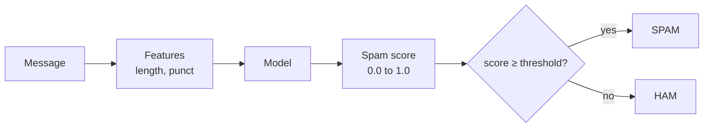
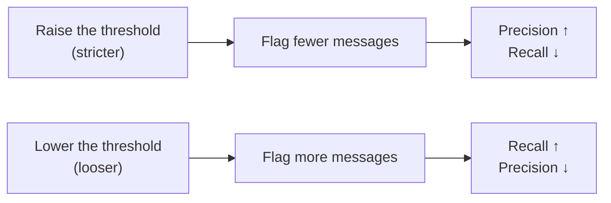
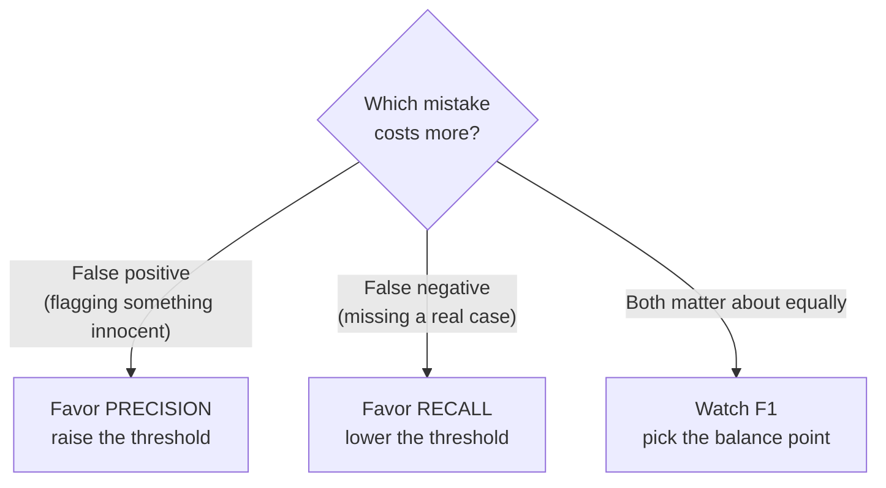

# Precision vs Recall 101

A plain-language guide to the metrics on slide 14, using our spam filter.

> **In one sentence:** *Precision* asks "when the model says spam, is it right?" *Recall* asks "of all the spam out there, how much did we catch?" You usually cannot max out both. Moving the **threshold** trades one for the other.

---

## 1. The four possible outcomes

Every message ends up in exactly one of four boxes:



The same thing as a **confusion matrix**:

|                    | Model says **ham** | Model says **spam** |
|--------------------|-------------------|--------------------|
| **Really ham**     | TN ✔ | FP ✘ (good email lost) |
| **Really spam**    | FN ✘ (scam gets through) | TP ✔ |

There are two different kinds of mistake. Precision and recall each watch **one** of them.

---

## 2. The four metrics, worked out

The slide's example: **10 messages, 4 of them spam.** The model flags 5 messages as spam.

| Outcome | Count |
|---|---|
| TP (spam, flagged) | 3 |
| FP (ham, flagged) | 2 |
| FN (spam, missed) | 1 |
| TN (ham, not flagged) | 4 |

| Metric | Question it answers | Formula | Example |
|---|---|---|---|
| **Precision** | When we flag spam, how often are we right? | TP / (TP + FP) | 3 / 5 = **60%** |
| **Recall** | Of all the real spam, how much did we catch? | TP / (TP + FN) | 3 / 4 = **75%** |
| **Accuracy** | How many messages did we get right overall? | (TP + TN) / all | 7 / 10 = **70%** |
| **F1** | One number that is high only if *both* P and R are high | 2 × P × R / (P + R) | 2 × 0.6 × 0.75 / 1.35 = **67%** |

**The trick to remembering it:** look at the denominator.



- Precision starts from the model's **predictions** ("flagged"). The mistake it punishes is **FP**.
- Recall starts from the **truth** ("real spam"). The mistake it punishes is **FN**.

### An everyday analogy: a fishing net

You want to catch salmon (spam) and leave everything else (ham) in the water.

- **Small net, used carefully:** almost everything you pull up is salmon (**high precision**), but many salmon get away (**low recall**).
- **Huge net:** you catch nearly every salmon (**high recall**), but you also haul up boots and seaweed (**low precision**).

---

## 3. Where the trade-off comes from: the threshold

Our model doesn't really output "spam" or "ham." It outputs a **probability** (a spam score from 0 to 1). We then pick a **threshold**: everything at or above it gets flagged.



> In scikit-learn, `model.predict()` uses a threshold of **0.5** without telling you. `model.predict_proba()` gives you the scores so you can choose your own threshold.

### Toy example: the same 10 messages, sorted by score

| Score | 0.95 | 0.85 | 0.70 | 0.60 | 0.55 | 0.45 | 0.35 | 0.25 | 0.15 | 0.05 |
|---|---|---|---|---|---|---|---|---|---|---|
| Truth | spam | spam | ham | spam | ham | spam | ham | ham | ham | ham |

Now slide the threshold:

| Threshold | Flagged | TP | FP | FN | Precision | Recall | What it feels like |
|---|---|---|---|---|---|---|---|
| **0.8** (strict) | 2 | 2 | 0 | 2 | **100%** | **50%** | Never wrong, but half the spam gets through |
| **0.5** (default) | 5 | 3 | 2 | 1 | **60%** | **75%** | The slide's example |
| **0.3** (loose) | 7 | 4 | 3 | 0 | **57%** | **100%** | All spam caught, but 3 real emails lost |



**That is the whole trade-off.** You are not choosing a better model. You are choosing **which mistake you would rather make**.

---

## 4. Real numbers from our lab

This is **model v1** from Part 1 of the lab, trained on the real data (85% ham, 15% spam) and scored on its 250 test messages (38 spam). Only the threshold changes:

| Threshold | Flagged | TP | FP | FN | Precision | Recall | F1 | Accuracy |
|---|---|---|---|---|---|---|---|---|
| 0.50 (default) | 3 | 0 | 3 | 38 | 0% | **0%** | 0% | **83.6%** |
| 0.30 | 40 | 24 | 16 | 14 | 60% | 63% | 62% | 88.0% |
| 0.25 | 56 | 30 | 26 | 8 | 54% | 79% | **64%** | 86.4% |
| 0.20 | 71 | 33 | 38 | 5 | 46% | 87% | 61% | 82.8% |
| 0.10 | 103 | 36 | 67 | 2 | 35% | 95% | 51% | 72.4% |
| 0.05 | 164 | 37 | 127 | 1 | 23% | **97%** | 37% | 48.8% |

What to notice:

1. **At the default 0.5, v1 catches nothing.** It flags only 3 messages, all wrong. That's the "accuracy trap" from slide 7: 83.6% accuracy, 0% recall.
2. **The same model becomes useful just by lowering the threshold.** At 0.25 it catches 79% of spam. Nothing was retrained.
3. **Going down the table, recall goes up and precision goes down.** At 0.05 we catch 37 of 38 spam, but 127 good emails go to the spam folder.
4. **Accuracy is a poor guide here.** It is highest at 0.30, yet a 0.5 model with 0% recall still scores 83.6%.
5. **F1 peaks in the middle (0.25),** where precision and recall are balanced.

---

## 5. Which one should I care about?

Ask: **"Which mistake costs more?"**



| Application | Worse mistake | Favor | Why |
|---|---|---|---|
| Email spam filter | FP: an interview offer lands in spam | **Precision** | Users forgive a little spam, not lost emails |
| Cancer screening | FN: a missed tumor | **Recall** | A false alarm only means a follow-up test |
| Credit card fraud alert | FN: fraud goes through | **Recall** | A false alarm is just a text message to confirm |
| Video "kids safe" filter | FN: unsafe video shown to a child | **Recall** | Better to hide some fine videos |
| Product recommendations | FP: an irrelevant suggestion | **Precision** | Bad suggestions erode trust; missing one costs little |
| Search results, page 1 | FP: junk at the top | **Precision** | Users only look at the first few results |

> **Common pattern:** a high-recall model catches everything suspicious, then a **human or a second model** reviews the flags to bring precision back up. Fraud teams and content moderators work this way.

---

## 6. Why F1 and not just the average?

F1 is the **harmonic mean** of precision and recall. It punishes a model that is great at one and terrible at the other.

| Precision | Recall | Plain average | F1 |
|---|---|---|---|
| 60% | 75% | 67.5% | **67%** |
| 100% | 10% | 55% | **18%** |
| 23% | 97% | 60% | **37%** |

A model that flags one message, correctly, has 100% precision. If it misses 90% of spam, F1 shows it is bad, while the plain average hides it.

---

## 7. What this means for MLOps

- **Gate on the metric that matches the cost.** In Part 4 of the lab, a model with 86.8% accuracy and 12% recall passed an accuracy-only gate. Add recall (or F1, or precision) to the gate.
- **The threshold is part of the model.** Save it in the model card and version it, just like the `.pkl` file. Changing it changes behavior in production.
- **Monitor both in production.** Drift can quietly lower recall (Part 6: recall fell to 1.6%) while accuracy still looks fine.
- **Report the confusion matrix,** not one number. It shows both kinds of mistake at once.

---

## 8. Try it yourself

Run this from the `lab-mlops-101` folder after `python make_data.py`:

```python
from sklearn.model_selection import train_test_split
from common import FEATURES, load_data, train

df = load_data("data/sms_real_1k.csv")
train_df, test_df = train_test_split(df, test_size=0.25, random_state=42, stratify=df["label"])
model = train(train_df)

spam_col = list(model.classes_).index("spam")
scores = model.predict_proba(test_df[FEATURES])[:, spam_col]   # spam score for each message
is_spam = (test_df["label"] == "spam").values

for threshold in [0.5, 0.3, 0.25, 0.2, 0.1, 0.05]:
    flagged = scores >= threshold
    tp = (flagged & is_spam).sum()
    fp = (flagged & ~is_spam).sum()
    fn = (~flagged & is_spam).sum()
    precision = tp / (tp + fp) if tp + fp else 0
    recall = tp / (tp + fn)
    print(f"threshold {threshold:.2f}  precision {precision:5.0%}  recall {recall:5.0%}")
```

**Challenge:** pick a threshold for a spam filter where **precision must be at least 50%**. What is the best recall you can get? (Answer below.)

---

## 9. Quick check

<details>
<summary><b>1.</b> A model flags 20 messages as spam. 15 really are spam. There are 30 spam messages in total. What are precision and recall?</summary>

Precision = 15 / 20 = **75%**. Recall = 15 / 30 = **50%**.
</details>

<details>
<summary><b>2.</b> A model never flags anything. What are its precision and recall?</summary>

Recall = 0 / (all spam) = **0%**. Precision is undefined (0 / 0); scikit-learn reports it as 0. Accuracy can still look high if spam is rare.
</details>

<details>
<summary><b>3.</b> Your manager says "too many customer emails are going to spam." Raise or lower the threshold? Which metric goes up?</summary>

**Raise** it. Fewer messages get flagged, so there are fewer false positives. **Precision goes up**; recall will probably go down.
</details>

<details>
<summary><b>4.</b> For a disease screening test, would you rather have 99% precision or 99% recall?</summary>

**99% recall**: missing a sick patient (FN) is usually far worse than a false alarm that leads to a second test (FP).
</details>

<details>
<summary><b>Challenge answer</b></summary>

From the table in section 4: thresholds 0.30 (60% precision) and 0.25 (54%) both keep precision at 50% or above. **0.25** gives the higher recall: **79%**. At 0.20, precision falls to 46%.
</details>
