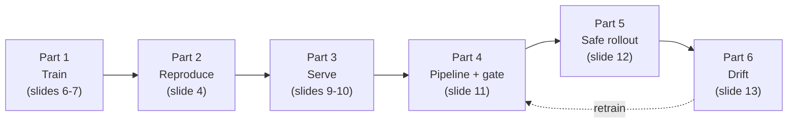
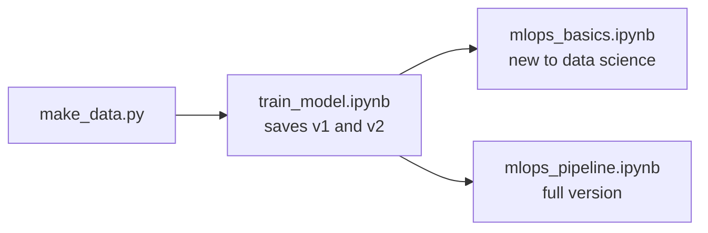

# MLOps 101 Lab: Spam Classifier

A short, hands-on lab that goes with the **MLOps 101** slides. You will take a tiny spam classifier from "trained once on a laptop" to "retrained by a pipeline, protected by a quality gate, and monitored for drift."

There are two ways to do the lab. Both tell the same story with the same data:

- **Command line:** Python scripts, following [IN_CLASS_LAB.md](IN_CLASS_LAB.md).
- **Notebooks:** three Jupyter notebooks, each with a Starter section (TODOs) and a Solution section.

| Document | Who it is for |
|---|---|
| [IN_CLASS_LAB.md](IN_CLASS_LAB.md) | **Students, command line.** Step-by-step lab to follow in class |
| [PRECISION_RECALL_101.md](PRECISION_RECALL_101.md) | **Students.** Plain-language guide to precision vs recall, the threshold trade-off and F1, with examples (slide 14) |
| [train_model.ipynb](train_model.ipynb) | **Students, notebooks, step 1.** Train v1 and v2; accuracy, precision, recall, F1 and the decision threshold |
| [mlops_basics.ipynb](mlops_basics.ipynb) | **Students new to data science, step 2.** The five big MLOps steps with short TODOs |
| [mlops_pipeline.ipynb](mlops_pipeline.ipynb) | **Students, step 2, full version.** Registry, gate, API, pipeline, rollback, shadow/canary/blue-green, drift |
| [azure-mlops/](azure-mlops/README.md) | **Advanced, on Azure.** The same loop with AutoML models in Azure Machine Learning: pipelines, managed endpoints, AutoML retraining, GitHub Actions |
| [INSTRUCTOR_GUIDE.md](INSTRUCTOR_GUIDE.md) | Instructor. Timing, slide mapping, talking points, common problems |
| [SOLUTION.md](SOLUTION.md) | Instructor (share after class). Answers and expected output |

## Where the lab fits in the slides



Slides 14–16 introduce the notebooks: the metrics (14), which notebook to run (15) and what students will see (16).

## Quick start: command line

```bash
pip install -r requirements.txt
python make_data.py
python train.py data/sms_real_1k.csv v1
```

Then follow [IN_CLASS_LAB.md](IN_CLASS_LAB.md).

## Quick start: notebooks

```bash
pip install -r requirements.txt jupyterlab
python make_data.py
jupyter lab
```

Then run the notebooks in this order:



1. **[train_model.ipynb](train_model.ipynb)** trains v1 (imbalanced data) and v2 (balanced data), and saves both as `models/model_nb_v1.pkl` and `models/model_nb_v2.pkl`, each with a `.json` model card. Run it all the way through first.

   > **Stuck on this notebook?** Run `python make_solution_models.py`. It trains v1 and v2 exactly as the notebook's solution does and saves the same four files, so you can go straight to step 2.
2. Then pick **one**:
   - **[mlops_basics.ipynb](mlops_basics.ipynb)**, if you are new to data science: save versions, quality gate, serve, retrain and roll back, watch for drift. Every TODO is one or two lines.
   - **[mlops_pipeline.ipynb](mlops_pipeline.ipynb)**, the full version, following slides 4–13: everything in the basics notebook plus reproducibility checks, data validation, shadow/canary/blue-green rollouts, a refreshed test set and an automated weekly job.

Each notebook's Solution section (Part B) runs on its own from top to bottom. The diagrams are Mermaid charts: they render in JupyterLab 4.1+, Notebook 7.1+ and VS Code.

## Files

```
lab-mlops-101/
├── README.md              # this file
├── IN_CLASS_LAB.md        # student lab, command-line version
├── INSTRUCTOR_GUIDE.md    # timing, slide mapping, talking points
├── SOLUTION.md            # answers and expected output
├── PRECISION_RECALL_101.md  # precision vs recall, thresholds and F1, explained
│
├── train_model.ipynb      # notebook 1: train v1 and v2, metrics, model cards
├── mlops_basics.ipynb     # notebook 2 (beginner): the five major MLOps steps
├── mlops_pipeline.ipynb   # notebook 2 (full): the whole MLOps loop
├── azure-mlops/           # advanced: the loop on Azure ML with AutoML models (see its README)
│
├── common.py              # shared code: features, train, evaluate
├── make_data.py           # creates the synthetic datasets
├── make_solution_models.py  # creates v1 and v2 as train_model.ipynb would (for notebooks 2 and 3)
├── train.py               # train one model + write its model card
├── predict.py             # classify a message with a saved model
├── pipeline.py            # ingest -> retrain -> evaluate -> version -> gate/promote  (has a TODO)
├── rollback.py            # put an older model back into production
├── check_drift.py         # monitoring: has the data changed?
├── app.py                 # optional: Streamlit web app
├── Dockerfile             # optional: package the app in a container
├── requirements.txt
└── data/
    ├── sms_real_1k.csv        # provided: real SMS features (85% ham, 15% spam)
    ├── balanced.csv           # created by make_data.py: 1,000 ham + 1,000 spam
    ├── test_set.csv           # created: the fixed test set (85% ham, 15% spam)
    └── new_week_*.csv         # created: ok, bad (labeling bug) and drift batches
```

Folders created when you run things:

| Folder | Created by | Holds |
|---|---|---|
| `models/` | `train.py`, `pipeline.py`, `train_model.ipynb` | Model files, model cards, `production.pkl`, `registry.csv` |
| `mlops_nb/` | `mlops_pipeline.ipynb` | That notebook's versions, registry and production model. Emptied each time its setup cell runs |
| `mlops_basics/` | `mlops_basics.ipynb` | That notebook's versions and production model. Emptied each time its setup cell runs |

The two MLOps notebooks never touch `models/production.pkl` or `models/registry.csv`, so they do not interfere with the command-line lab.

## Troubleshooting

**`FileNotFoundError: models/production.pkl`**

`models/production.pkl` does not exist until the pipeline promotes a model in Part 4a. `predict.py` (with no model argument), `app.py`, `check_drift.py` and the Docker build all need it. Create it with:

```bash
python pipeline.py data/new_week_ok.csv
```

Run every script from inside `lab-mlops-101/`. The paths are relative, so running from another folder gives the same error even when the file exists.

**`models/model_nb_v1.pkl is missing` in an MLOps notebook**

Run all of `train_model.ipynb` first. It saves the two models the MLOps notebooks start from. If you could not finish it, run `python make_solution_models.py` instead: it creates the same two models.

**`Finish the TODO ...` or `The registry should have v1 and v2`**

A starter cell still has an unfilled `# TODO`. Fill it in, or copy the matching cell from Part B, then run the cell again.

**`mlops_nb/versions/v2.pkl does not exist`**

Section 1c of `mlops_pipeline.ipynb` registers v1 and v2. Run it before the later sections. If you re-ran the setup cell, it emptied `mlops_nb/`: run every cell after it again.

**Diagrams show up as text starting with `flowchart`**

Your Jupyter is older than JupyterLab 4.1 / Notebook 7.1. Upgrade with `pip install -U jupyterlab`, or open the notebook in VS Code. The code cells work either way.
