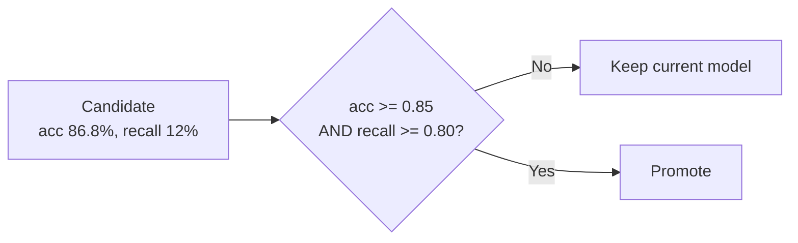

# Solution: MLOps 101 Lab

> For instructors. Share with students after the lab.
> All numbers come from a real run. Because `make_data.py` uses a fixed seed, students should see the same numbers. Only the timestamps in version names will differ.
>
> **Notebook track:** the answers to the notebook questions are in **Part B** of each notebook ([train_model.ipynb](train_model.ipynb), [mlops_basics.ipynb](mlops_basics.ipynb), [mlops_pipeline.ipynb](mlops_pipeline.ipynb)), next to the code that produces them. The key numbers are summarised at the end of this file.

---

## Part 1 · Train and the accuracy trap

| Model | Data | Accuracy | Spam recall |
|---|---|---|---|
| v1 | real, imbalanced (85/15) | **83.6%** | **0.0%** |
| v2 | balanced (50/50) | **98.8%** | **98.8%** |

v1 output:

```
  Accuracy    : 83.6%
  Spam recall : 0.0%   (share of real spam we caught)
  Confusion matrix:
                    predicted ham   predicted spam
    actual ham                209                3
    actual spam                38                0
```

**Q1.** v1 predicts "ham" for almost every message. It caught **0 of 38** spam messages. Its accuracy comes entirely from the fact that most messages are ham.

**Q2.** With 85% ham, a model that *always* says ham scores about 85% accuracy while being useless. Accuracy hides how the model does on the rare class we actually care about. Use recall (and precision) for the spam class, plus the confusion matrix.

---

## Part 2 · Reproducible and accountable

Example model card (`models/model_v2.json`):

```json
{
  "version": "v2",
  "created_at": "2026-10-16T07:56:39",
  "data_file": "data/balanced.csv",
  "data_fingerprint": "a9bab24247fd",
  "rows": 2000,
  "algorithm": "LogisticRegression",
  "metrics": {
    "accuracy": 0.988,
    "spam_recall": 0.988,
    "confusion_matrix": [[247, 3], [3, 247]]
  }
}
```

**Q3.** The metrics are identical on every run. `random_state=42` makes the train/test split the same each time, and the data file has not changed. Only `created_at` changes.

**Q4.** `data_fingerprint` is a hash of the training file. It changes if even one row of data changes. Months later, it lets you prove exactly which data produced a model (*accountable*), and it lets you check that you are retraining on the same data (*reproducible*). Tools like DVC do this at scale.

---

## Part 3 · Serve the model

```
Message    : See you at lunch
Features   : {'length': 16, 'punct': 0}
Prediction : HAM

Message    : URGENT! You have won a 1000 dollar gift card. Call 0800-123-456 now ...
Features   : {'length': 131, 'punct': 9}
Prediction : SPAM

Message    : WINNER!! Claim your free prize now!!!
Features   : {'length': 37, 'punct': 5}
Prediction : HAM
```

**Q5.** The model only sees *length* and *punctuation count*. `WINNER!!...` is short (37 characters) with moderate punctuation, which looks like a typical ham message (about 50 characters, about 3 marks). The model never sees the words "WINNER" or "prize."

**Q6.** It needs to look at the **content**: words, phrases, URLs and phone numbers. Options include bag-of-words or TF-IDF with a linear model, or deep learning (embeddings, RNNs, transformers) that learns useful text features automatically.

---

## Part 4 · A pipeline with a quality gate

### 4a. A normal week: passes

```
[3/5] Evaluate on fixed test set (data/test_set.csv)
  Accuracy    : 99.4%
  Spam recall : 100.0%
[5/5] Quality gate
  PASSED -> promoted to models/production.pkl
```

### 4b. A bad week: passes the accuracy-only gate

```
[3/5] Evaluate on fixed test set (data/test_set.csv)
  Accuracy    : 86.8%
  Spam recall : 12.0%   (share of real spam we caught)
  Confusion matrix:
                    predicted ham   predicted spam
    actual ham                425                0
    actual spam                66                9
[5/5] Quality gate
  PASSED -> promoted to models/production.pkl
```

**Q7.** Yes, it passed, because 86.8% is above 85%. But it catches only **9 of 75** spam messages (12%). It must **not** be in production. The gate made the same mistake as slide 7: it trusted accuracy on imbalanced data.

### 4c. The fixed gate

```python
# ---------------- Quality gate ----------------
ACCURACY_MIN = 0.85
SPAM_RECALL_MIN = 0.80


def passes_gate(metrics: dict) -> bool:
    """Return True if the candidate model is good enough for production."""
    ok = metrics["accuracy"] >= ACCURACY_MIN
    ok = ok and metrics["spam_recall"] >= SPAM_RECALL_MIN
    return ok
# ----------------------------------------------
```

An equally good one-line version:

```python
    return metrics["accuracy"] >= ACCURACY_MIN and metrics["spam_recall"] >= SPAM_RECALL_MIN
```

### 4d. Roll back and rerun

```bash
python rollback.py model_20261016_075715      # the version from 4a (yours will differ)
python pipeline.py data/new_week_bad.csv
```

```
  Accuracy    : 86.8%
  Spam recall : 12.0%
[5/5] Quality gate
  FAILED -> models/production.pkl was NOT changed
```

`models/registry.csv` (your names and number of rows will differ):

```
version,new_data,train_rows,accuracy,spam_recall,promoted
model_20261016_075715,data/new_week_ok.csv,2500,0.994,1.0,True
model_20261016_075717,data/new_week_bad.csv,3800,0.868,0.12,False
```

**Q8.** The gate blocked the bad model, so production kept the good one. We save every version so we can **roll back** instantly, **compare** models over time, and **investigate** what went wrong (the registry shows which data batch caused the drop). The rejected model is evidence of the labeling bug.



---

## Part 5 · Ship it safely

**Q9.**
- **Shadow** finds the problem with **zero** user impact. The new model runs on real traffic, but users only see the current model's answer. Comparing the two would show the new model saying "ham" far more often.
- **Canary** exposes only 5–10% of users, so the impact is limited but not zero.
- **Blue/green** gives the **fastest rollback**: switch the router back to the old environment.

---

## Part 6 · Monitoring and drift

```
Drift check: data/new_week_ok.csv vs data/balanced.csv
  length  training avg  151.0 | new avg  149.7 | change -1%  -> ok
  punct   training avg   12.0 | new avg   12.8 | change +7%  -> ok
```

```
Drift check: data/new_week_drift.csv vs data/balanced.csv
  length  training avg  151.0 | new avg   45.4 | change -70%  -> DRIFT
  punct   training avg   12.0 | new avg    5.9 | change -51%  -> DRIFT

How does the production model do on this new data?
  Accuracy    : 50.2%
  Spam recall : 1.6%
ALERT: drift detected. Time to collect new labels and retrain.
```

**Q10.** Both features drifted **down**. Spam messages became about 70% shorter and carry about half the punctuation. The production model's spam recall dropped from about 100% to **1.6%**. Spammers learned to look like ham.

After retraining on the drifted batch:

```
python pipeline.py data/new_week_drift.csv
  Accuracy    : 95.2%
  Spam recall : 97.3%
  PASSED -> promoted to models/production.pkl

python check_drift.py data/new_week_drift.csv
  Accuracy    : 64.4%
  Spam recall : 33.2%
ALERT: drift detected. ...
```

**Q11.** Two reasons:
1. **The test set is old.** `test_set.csv` only contains the *old* kind of spam, so the gate measures the wrong thing. In production, add fresh labeled data to the test set too.
2. **The features are too weak.** Short spam (about 45 characters) and ham (about 50 characters) look almost the same in `length` and `punct`. No amount of retraining can separate them. We need better features, such as the text itself, or a deep learning model. (The drift alert still fires because `check_drift.py` compares against the original `balanced.csv`. After retraining you would update that reference data.)

---

## Wrap-up

**Q12.** Example answers:
- *Reproducible:* Part 2. The same seed and the same data give the same metrics, and the model card records how the model was made.
- *Accountable:* Parts 2 and 4. The data fingerprint and `registry.csv` trace every model back to its data, and show which batch caused the problem.
- *Continuous:* Parts 4 and 6. The pipeline retrains and gates automatically, and drift monitoring tells us when to run it.

**Q13.** Any of these: automatic retraining triggered by drift alerts; CI/CD (for example GitHub Actions) that runs the pipeline and rebuilds the Docker image; shadow or canary deployment; refreshing the test set with new labeled data; data versioning with DVC; alerts sent to Slack; explainability with SHAP or LIME.

---

## Notebook track: key numbers

From `train_model.ipynb` (on the fixed `test_set.csv`):

| Model | Accuracy | Precision | Recall | F1 |
|---|---|---|---|---|
| v1 (real, imbalanced) | 85.6% | 100% | 4% | 7.7% |
| v2 (balanced) | 99.0% | 93.8% | 100% | 96.8% |

v1's 100% precision comes from flagging only 3 messages. The worked 10-message example gives accuracy 70%, precision 60%, recall 75% and F1 67%. On v1, lowering the threshold to 0.25 raises F1 from 0 to 0.64.

From `mlops_pipeline.ipynb` and `mlops_basics.ipynb` (the registry at the end):

| Version | Trained on | Accuracy | Recall | What happens |
|---|---|---|---|---|
| v1 | `sms_real_1k.csv` | 85.6% | 4% | Passes the accuracy-only gate, fails the recall rule |
| v2 | `balanced.csv` | 99.0% | 100% | First production model |
| v3 | base + `new_week_ok` | 99.4% | 100% | Promoted |
| v4 | base + `new_week_bad` | 86.8% | 12% | Promoted by the accuracy-only gate, then rolled back to v3 |
| v5 | base + `new_week_bad` | 86.8% | 12% | Blocked by the recall rule |
| v6 | base + half the drift week | 97.8% | 98.7% | Passes on the old test set; production at the end (full notebook only) |
| v7 | same data as v6 | 85.7% | 54% | Fails on the refreshed test set; a human is alerted (full notebook only) |

## Full run (instructor dry run)

```bash
pip install -r requirements.txt
python make_data.py
python train.py data/sms_real_1k.csv v1
python train.py data/balanced.csv v2
python predict.py "WINNER!! Claim your free prize now!!!" models/model_v2.pkl
python pipeline.py data/new_week_ok.csv
python pipeline.py data/new_week_bad.csv        # passes: the trap
# edit pipeline.py: add SPAM_RECALL_MIN = 0.80 to the gate
python rollback.py <version from new_week_ok run>
python pipeline.py data/new_week_bad.csv        # now fails
python check_drift.py data/new_week_ok.csv
python check_drift.py data/new_week_drift.csv
python pipeline.py data/new_week_drift.csv
python check_drift.py data/new_week_drift.csv
```
