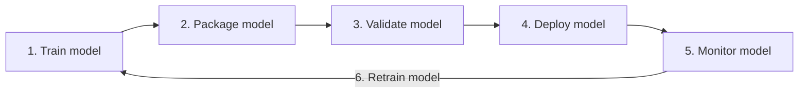

# Azure MLOps: AutoML Models in Production

An advanced, cloud version of the MLOps 101 lab. It takes two **Automated ML** models registered in an Azure Machine Learning workspace through a production MLOps loop: registry and lineage, an evaluation pipeline with a quality gate, a managed online endpoint with blue/green, shadow and canary rollouts, drift monitoring, AutoML retraining and GitHub Actions CI/CD.

It follows the Microsoft Learn path [Introduction to machine learning operations (MLOps)](https://learn.microsoft.com/en-us/training/paths/introduction-machine-learn-operations/), using the Azure ML Python SDK v2 (`azure-ai-ml`) and MLflow.

## The MLOps lifecycle



*The machine learning lifecycle, after the diagram in Microsoft Learn's [Introduction to DevOps principles for machine learning](https://learn.microsoft.com/en-us/training/modules/introduction-development-operations-principles-for-machine-learn/).*

Each step maps to part of the notebook:

| Step | What it means | In this notebook |
|---|---|---|
| 1. Train model | Fit a model on versioned data | AutoML trained `balanced_model` and `sms_real_1k`; section 8 retrains from code |
| 2. Package model | Save the model with its dependencies so it runs anywhere | MLflow model format and its `conda.yaml`, registered in the model registry (sections 1–2) |
| 3. Validate model | Test it on data it has never seen, against fixed rules | Evaluate-and-gate pipeline on the fixed test set, results stored as registry tags (sections 3–4) |
| 4. Deploy model | Serve it safely to users | Managed online endpoint with blue/green, shadow and canary rollout (sections 5–6) |
| 5. Monitor model | Watch for drift and failures in production | Drift reports through the live endpoint, logged to MLflow (section 7) |
| 6. Retrain model | Close the loop when the world changes | AutoML job on new data, judged by the same gate; automated with GitHub Actions (sections 8–9) |

> ⚠️ **Creates billable Azure resources** (a compute cluster, an online endpoint, an optional AutoML job). Run the notebook's **Clean up** section when you finish.

## What you need

- An Azure ML workspace with two AutoML classification models registered as MLflow models. The notebook defaults to `balanced_model:1` (champion) and `sms_real_1k:1` (challenger), trained on the lab's `balanced.csv` and `sms_real_1k.csv` (columns `label`, `length`, `punct`).
- Permission to create jobs, compute and endpoints (Contributor or AzureML Data Scientist on the workspace).
- Quota for `Standard_DS3_v2` (up to 3 instances at once).
- Python 3.9+ and `pip install -r requirements.txt`.

## Run it

### 1. Tell the notebook which workspace to use: `.env`

Copy the template and fill in your subscription ID and resource group:

```bash
cp env.sample .env
```

```ini
# .env
SUBSCRIPTION_ID = "<your-subscription-id>"
RESOURCE_GROUP = "<your-resource-group>"
WORKSPACE = "ml_5350"
```

To find the values:
- **Azure portal:** open your Azure Machine Learning workspace. *Overview* shows the **Subscription ID** and **Resource group**.
- **Azure CLI:** after `az login`, run `az account show --query id -o tsv` for the subscription ID, and `az resource list --resource-type Microsoft.MachineLearningServices/workspaces -o table` for the resource group of each workspace.

`.env` is **git-ignored**, so your IDs stay on your machine. Commit `env.sample` (the template), never `.env`. The notebook reads `.env` in its first cell and prints only the first 8 characters of the subscription ID.

Other options, if you prefer:
- **`config.json`:** studio → top-right menu → *Download config file*, saved in this folder (also git-ignored).
- **Type the values** in the notebook's first code cell, for a quick test.

If more than one is set, `config.json` wins, then `.env`, then the values in the cell.

### 2. Sign in and open the notebook

```bash
pip install -r requirements.txt
az login --tenant <your-tenant-id>      # or let the notebook open a browser to sign in
jupyter lab azure_mlops.ipynb
```

If you have several subscriptions, `az login` asks you to pick a default. Any choice works: the notebook uses the subscription in `.env`.

## What is in this folder

```
azure-mlops/
├── azure_mlops.ipynb              # the notebook (sections 0-11, questions and answers)
├── src/
│   ├── evaluate.py                # scores an MLflow model on a test CSV -> metrics.json
│   └── gate.py                    # the promotion rules -> decision.json
├── components/
│   ├── evaluate.yml               # Azure ML component wrapping evaluate.py
│   └── gate.yml                   # Azure ML component wrapping gate.py
├── pipelines/evaluate-and-gate.yml  # champion + challenger evaluation, then the gate
├── endpoints/
│   ├── endpoint.yml               # managed online endpoint
│   └── deployment.yml             # MLflow no-code deployment (blue or green)
├── tests/test_gate.py             # unit tests for the gate (pytest)
├── ci/azure-mlops.yml             # GitHub Actions workflow template
├── env.sample                     # template: copy to .env and fill in your IDs
├── config.example.json            # the config.json alternative
└── requirements.txt
```

The notebook and the CI workflow use the **same** YAML files and scripts, so what you test by hand is exactly what automation runs.

## Notebook sections

| # | Section | MS Learn module |
|---|---|---|
| 0 | Connect with `MLClient` and MLflow | |
| 1 | Registry, lineage, AutoML metrics and MLflow signatures | DevOps principles |
| 2 | Versioned data assets, an environment from the model's `conda.yaml`, a cluster that scales to zero | Automate workflows |
| 3 | Evaluate-and-gate **Azure ML pipeline** on the fixed test set | Automate workflows |
| 4 | Gate results as **registry tags** | Continuous deployment |
| 5 | **Managed online endpoint**, no-code MLflow deployment, smoke test | Continuous deployment |
| 6 | Blue/green, **mirror traffic** (shadow), canary, and a traffic policy that enforces the gate | Continuous deployment |
| 7 | Drift monitoring through the live endpoint, logged to MLflow | DevOps principles |
| 8 | Optional **AutoML retraining job** from code, then the same gate | Automate workflows |
| 9 | **GitHub Actions**: tests → gate pipeline → approval → canary | Source control, Automate, CD |
| 10 | The maturity ladder | |
| 11 | Clean up | |

## Turn on the CI workflow

1. Copy `ci/azure-mlops.yml` to `.github/workflows/azure-mlops.yml` at the root of your repository. If this folder is not at the repository root's `azure-mlops/`, change `WORKDIR` in the workflow.
2. Register an app in Microsoft Entra ID with a **federated credential** for your repository, and give it a role on the workspace's resource group. See [Use GitHub Actions with Azure Machine Learning](https://learn.microsoft.com/azure/machine-learning/how-to-github-actions-machine-learning).
3. Add secrets `AZURE_CLIENT_ID`, `AZURE_TENANT_ID` and `AZURE_SUBSCRIPTION_ID`, and variables `AZURE_RESOURCE_GROUP`, `AZURE_ML_WORKSPACE` and `AZURE_ML_ENDPOINT`.
4. Create a `production` environment with required reviewers (*Settings → Environments*).
5. Run it from *Actions → azure-mlops → Run workflow*. It never runs on push.

## Test without Azure

The gate's rules and the evaluation script run locally:

```bash
python -m pytest -q tests
```
